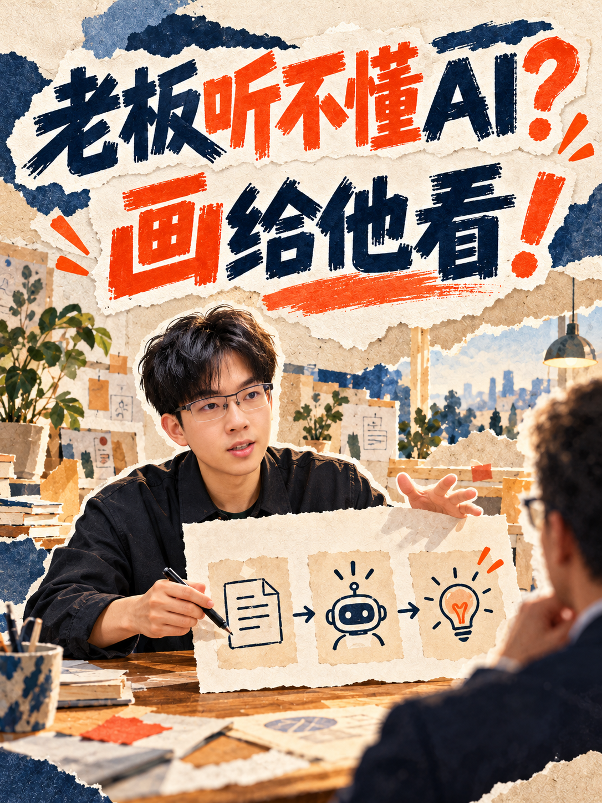
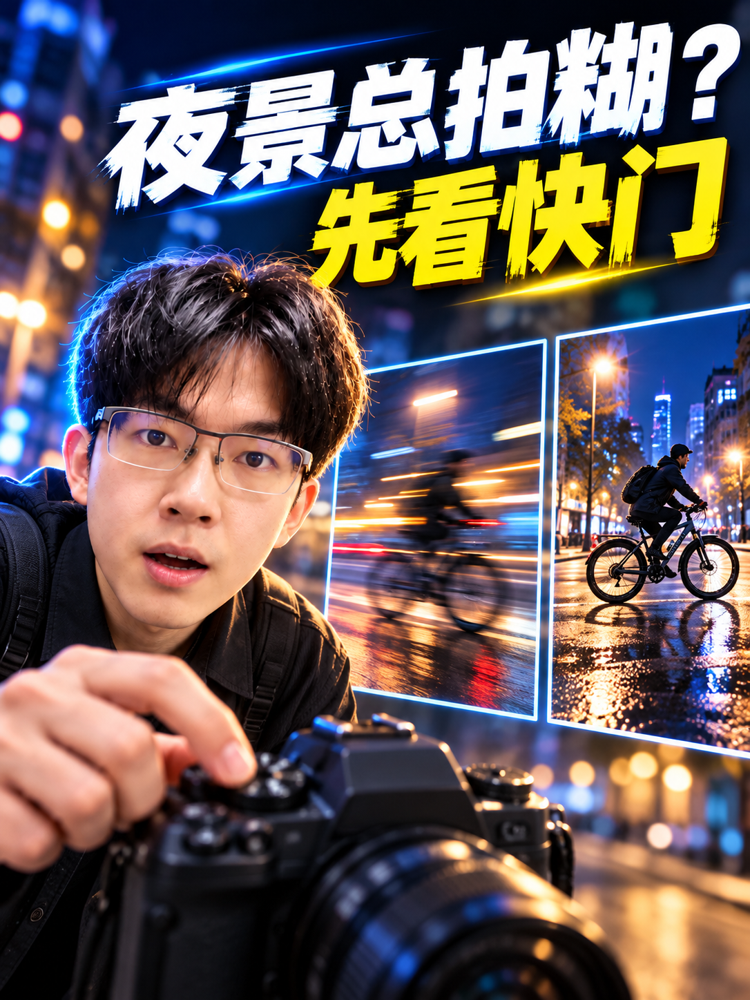
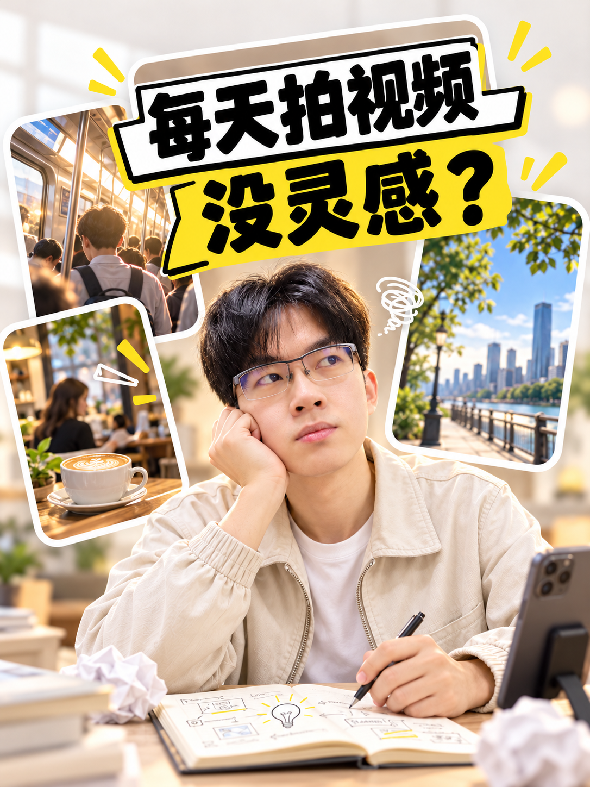
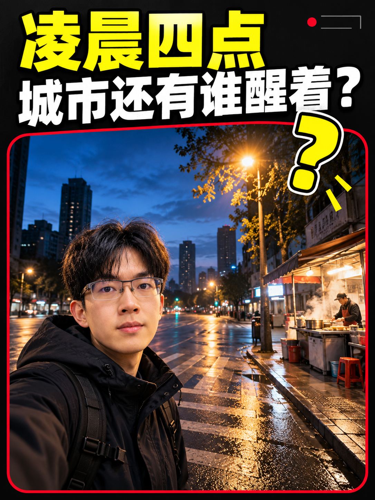
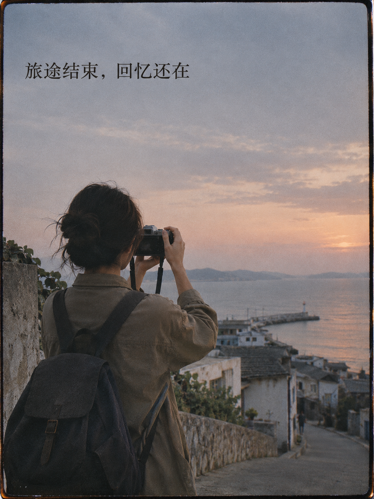
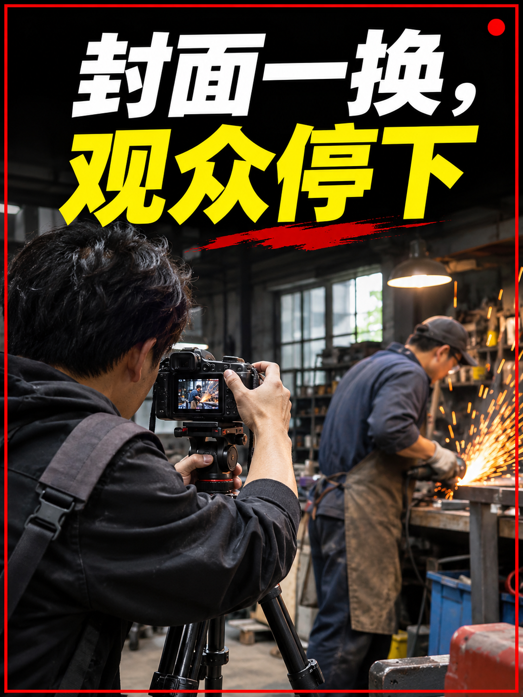

# azheAI-Cover-Designer

把一期中文口播视频的话题或稿件，做成三张可比较的 **3:4 竖版封面**。你选定一张后，再制作对应的 **4:3 横版封面**。

第一次生成含本人人物的封面时，Skill 会请你上传一张清晰的大头照，保存在你自己的头像库。以后做封面可以复用，不必每次重新上传。你也可以上传几张同一风格的图片，把它们存为自己的可调用风格。

## 看看效果

八种内置风格，都能直接在 GitHub 预览。卡片标题是各风格的**选题示例**；调用时使用标出的风格名，Skill 会根据你的真实话题或稿件重新设计文字、人物动作和场景。点击图片可看大图。

| **老板听不懂 AI？画给他看！** | **夜景总拍糊？先看快门** | **旧照片能变短片？** |
| --- | --- | --- |
| <a href="assets/style-library/04-paper-explainer.png"></a><br>调用名：`纸感叙事拼贴`<br>适合：方法拆解、工作流程、复杂概念 | <a href="assets/style-library/dark-electric-candidates/B-night-shutter.png"></a><br>调用名：`深色电光教程`<br>适合：摄影技巧、设备测评、技术教学 | <a href="assets/style-library/bright-cobalt-candidates/A-old-photo-film.png"></a><br>调用名：`亮蓝卡片展示`<br>适合：步骤展示、方案对比、变化过程 |

| **每天拍视频，没灵感？** | **凌晨四点，城市还有谁醒着？** | **免费 APP 靠什么赚钱？** |
| --- | --- | --- |
| <a href="assets/style-library/07-light-content-ideas.png"></a><br>调用名：`浅色生活卡片`<br>适合：生活方式、个人经验、创作心得 | <a href="assets/style-library/black-red-documentary-candidates/B-city-at-four-am.png"></a><br>调用名：`黑红纪实悬念`<br>适合：现场纪实、实地探访、观察实验 | <a href="assets/style-library/editorial-topic-collage-candidates/C-free-app-business.png"></a><br>调用名：`深色议题拼贴`<br>适合：商业逻辑、社会议题、知识解释 |

| **旅途结束，回忆还在** | **封面一换，观众停下** |
| --- | --- |
| <a href="assets/style-library/film-documentary/travel-memory.png"></a><br>调用名：`电影胶片纪实`<br>适合：旅行回忆、生活记录、情绪叙事 | <a href="assets/style-library/black-red-impact/cover-change.png"></a><br>调用名：`黑红现场冲击`<br>适合：实操演示、现场探访、变化对比 |

完整样图和设计要点见[风格参考库](references/style-library.md)。新加入的两种风格使用重新制作的公开示意图；用户上传的原始参考拼图没有进入仓库。示例里的人物只用于展示视觉方法；**你的封面只使用你上传的照片作为人物身份参考**。

## 一分钟开始

在有图片生成能力、能读写本地文件的 Codex 环境中使用。

### 1. 安装

从仓库主页点击 **Code → Download ZIP** 下载最新版源码包，在 Codex 对话中上传，然后发送：

```text
请把我上传的 azheai-cover-designer-main.zip 安装为我的个人 Codex Skill，并检查安装后的 azheai-cover-designer/SKILL.md 是否可读。安装好后，引导我第一次使用：如果我还没有保存头像，请先请我上传一张清晰的大头照。
```

Codex 应把压缩包中的 `azheai-cover-designer-main/` 文件夹改名为 `azheai-cover-designer/`，再放入个人 Skills 目录，并保留其中的 `SKILL.md`、`references/`、`assets/` 和 `agents/`。你也可以手动解压安装；目录结构应为：

```text
个人 Skills 目录/
└── azheai-cover-designer/
    ├── SKILL.md
    ├── README.md
    ├── agents/
    ├── references/
    └── assets/
```

当前 Codex 官方文档列出的个人 Skill 目录是 `~/.agents/skills/`（Windows 为用户主目录下的 `.agents\skills\`）。如果安装后没有出现在 Skill 列表中，重启 Codex 再试。参见 [Codex Skill 文档](https://learn.chatgpt.com/docs/build-skills)。

### 2. 第一次上传头像

安装后，第一次调用 `$azheai-cover-designer`，如果头像库为空，它会先请你上传清晰的大头照。照片尽量正面或轻微侧面、无遮挡、光线均匀，能看清五官。可以直接在安装对话中继续，也可以新开对话调用。

你会看到类似这样的引导：

> 请上传一张清晰的大头照，作为以后封面的人物参考。收到后我会保存在你自己的头像库，再开始做本期封面。

头像默认保存在你本机的 `~/.codex/skill-data/azheai-cover-designer/identity/`；如果环境无法写入这个位置，Skill 会使用可写的专用目录并告诉你路径。**头像不会加入公开 Skill 包，也不会被下一位使用者继承。**

### 3. 说出本期内容

头像就绪后，按下面任一种方式输入。下一次使用时，直接从这一步开始。

**只给话题：**

```text
使用 $azheai-cover-designer 做一期口播封面。话题是“逆光拍人，为什么背景好看但脸很黑”。这期会讲怎么用反光板和补光调整。先给我三张 3:4 候选。
```

**给内容提要或上传稿件：**

```text
使用 $azheai-cover-designer。请根据我上传的口播稿设计封面。目标观众是刚开始拍视频的人；希望标题具体说明观众能解决什么问题。先生成三张 3:4 候选。
```

**指定风格：**

```text
使用 $azheai-cover-designer。我这期讲如何把旧照片做成一段回忆短片。用“亮蓝卡片展示”风格，设计三张 3:4 封面，标题和画面都围绕这期内容，不沿用风格参考图的题材。
```

不指定风格时，默认使用“纸感叙事拼贴”。你也可以说“让三张分别尝试不同风格”。

### 添加你自己的风格

上传几张视觉语言相近的图片，再用一句话说清你想借鉴什么。首次操作无需先上传头像；只有开始制作含本人人物的封面时才需要头像。

```text
使用 $azheai-cover-designer，添加风格图：我上传的这 3 张图属于同一风格，命名为“雨夜街头手账”。要点是雨夜暖灯、手写小字、街道实拍和私密的日记感。请保存，供我以后做封面时调用。
```

保存成功后会得到类似回复：

> 已保存为「雨夜街头手账」，共 3 张参考图。以后可以说：使用 `$azheai-cover-designer`，用「雨夜街头手账」风格，为我这期讲……的视频生成三张封面。

下次直接输入：

```text
使用 $azheai-cover-designer，用“电影胶片纪实”风格做封面。这期讲第一次独自旅行，重点是出发前最容易漏掉的三件事。先给我三张 3:4 候选。
```

你也可以说“使用 `$azheai-cover-designer`，列出我的风格”。个人风格图和描述默认保存在 `~/.codex/skill-data/azheai-cover-designer/styles/`，与公开 Skill 包分开；每组图都有自己的名称和说明。上传的参考图只决定视觉方法，图中人物、文字和题材不会被照搬。

### 4. 从三张中选一张

Skill 会展示 **A、B、C 三张独立的 3:4 PNG**，并为每张说明封面文字、点击理由和设计动作。下面是回复形式示意，实际图片和文案以你的稿件为准：

> **A｜逆光拍人，脸怎么亮？** 聚焦人脸太暗的问题，用人物、夕阳和反光板呈现解决方法。  
> **B｜天空好看，人脸却黑？** 用明亮背景与暗脸的对照突出常见失误。  
> **C｜逆光人像，先补哪里？** 用可见的补光前后关系突出操作步骤。  
> 请选 A、B 或 C；也可以说“用 A 的标题，加上 B 的画面”。选定后我会再制作 4:3 横版。

你可以直接回复：

```text
选 A。标题保留，把左边的补光板再明显一点，然后做对应的 4:3 横版。
```

竖版会先按你的意见调整，再重新排版生成横版；横版不会直接拉伸竖版。

## 使用边界

- 风格库图片只提供色彩、材质、字级和构图方法；封面内容必须来自你的话题或稿件。
- Skill 不会凭空编造视频中没有的数字、案例结果或产品能力。话题太宽、会影响封面主旨时，它会问一个简短问题。
- 图片生成可能出现中文错字或人物不像本人；交付前应检查并修正。
- “爆款”是设计目标，不保证播放量或点击率。

## 包含什么

`SKILL.md` 是执行说明；`references/style-library.md` 解释内置风格；`assets/style-library/` 存放内置风格示例；`agents/openai.yaml` 提供 Skill 列表中的显示名称和默认提示词。**个人头像、个人风格图、稿件和生成结果不包含在发布包中。**

## 许可与示例图片

Skill 的执行说明、文档和配置采用 [MIT 许可证](LICENSE)，可以使用、修改和再分发。欢迎分享仓库链接和原样示例图来介绍本 Skill，注明「阿哲 / azheAI-Cover-Designer」即可。`assets/style-library/` 中的示例图片单独适用[图片与人物形象说明](ASSET-NOTICE.md)：可以在运行本 Skill 时作为风格参考，不能把示例中的人物形象当作自己的封面素材、代言或身份参考。
