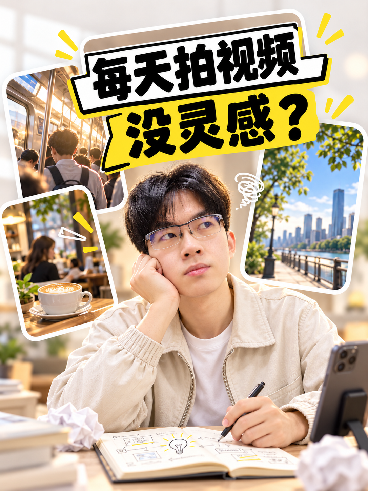
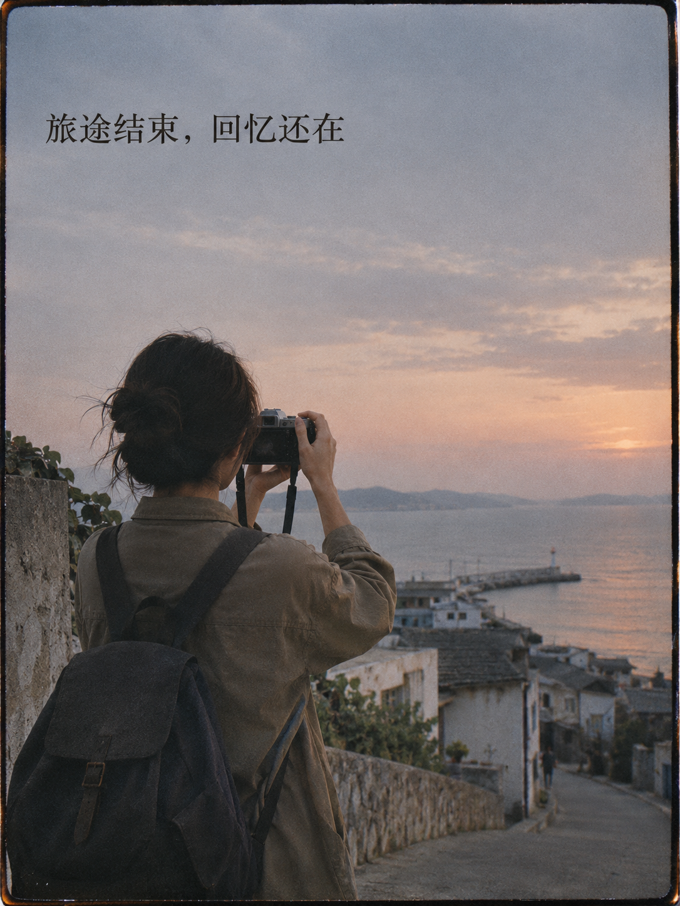
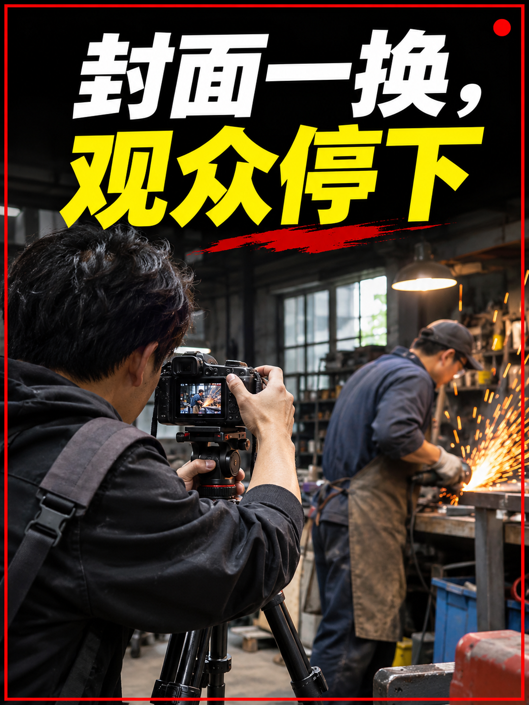

# 风格参考库

下列图片是八种内置风格的示意图。示例标题用于展示信息表达与字号层级，不是用户新封面的固定文案。部分图片使用创作者本人形象作为宣传示范；其他使用者生成封面时，必须以自己上传的头像为人物身份参考。所有图片只供借鉴视觉方法，不提供可复用的人物、文案、题材或固定构图。

## 风格一：纸感叙事拼贴（默认）

| 图片 | 可借鉴的设计动作 | 适合的内容 |
| --- | --- | --- |
| [04 画给老板看](../assets/style-library/04-paper-explainer.png) | “老板听不懂 AI？画给他看！”用桌面图解和人物讲解动作，把复杂话题变成可见的工作过程 | 方法拆解、工作流程、复杂概念 |
| [01 桌面行动](../assets/style-library/01-desk-action.png) | 暖白纸面、深色笔触大字、人物在具体工作动作中；局部橙色强调 | 方法、实操、业务动作 |
| [02 路径转折](../assets/style-library/02-path-turn.png) | 以一条可见路径表达从混乱到清晰，深青主色与朱红强调 | 问题拆解、转变、决策过程 |
| [03 两种选择](../assets/style-library/03-two-choices.png) | 用人物与两个空间的关系表达取舍，深靛蓝与黄绿对比 | 观点对照、选择、反常识判断 |

共同语言：大字先被读到，轻微纸纤维与剪贴层次提供质感；下半部用人物动作和具体场景解释主句。可随话题调整颜色、场景和构图。

## 风格二：深色电光教程

这一方向收录逆光人像、夜景快门和广角近拍三张 3:4 示例。视觉语言是深色底、白黄超大标题、蓝色轮廓光、可辨认的人物表情与动作，以及与标题对应的真实拍摄场景。每张示例只讲一件事；实际使用时从本期内容另写标题、另选场景。

| 候选 | 设计动作 | 图片 |
| --- | --- | --- |
| A 逆光人像 | “逆光拍人，脸怎么亮？”用夕阳逆光、相机与反光板交代拍摄问题和补光方法 | [查看 A](../assets/style-library/dark-electric-candidates/A-backlit-portrait.png) |
| B 夜景快门 | “夜景总拍糊？先看快门”用手调相机与同一骑行场景的拖影／清晰对照说明点击理由 | [查看 B](../assets/style-library/dark-electric-candidates/B-night-shutter.png) |
| C 广角近拍 | “广角贴脸拍，脸会变形？”用同一人物近距离／较远距离的人像对照呈现透视差异 | [查看 C](../assets/style-library/dark-electric-candidates/C-wide-angle-portrait.png) |

这三张展示同一视觉语言如何讲清不同的摄影问题，并非固定模板。实际生成先从当期稿件提炼观众关心的具体问题或收益，再写与之相符的标题，最后设计人物动作和可见场景。不要用只描述变化的悬念，也不要重复上述示例标题；若讲广角近拍，人脸透视变化主要与拍摄距离有关，文案不能误写成镜头本身必然使脸变形。

## 风格三：亮蓝卡片展示

这一方向的三张 3:4 示例分别讲旧照片变短片、普通咖啡拍出广告感、周末路线规划。视觉语言是钴蓝与冰蓝的高亮色场、白黄大字、具有空间层次的卡片，以及与标题直接相关的人物动作。实际生成时由本期稿件决定标题、卡片内容和场景。

| 候选 | 设计动作 | 图片 |
| --- | --- | --- |
| A 旧照片变短片 | “旧照片能变短片？”用手中的老照片与三张逐步鲜活的视频画面卡构成可见转变 | [查看 A](../assets/style-library/bright-cobalt-candidates/A-old-photo-film.png) |
| B 咖啡广告感 | “普通咖啡拍出广告感”用拍摄动作、咖啡杯与不同光线下的成片卡解释结果 | [查看 B](../assets/style-library/bright-cobalt-candidates/B-coffee-commercial.png) |
| C 周末路线 | “周末去哪？AI排好路线”用手机与三张地点卡表达可执行的出行选择 | [查看 C](../assets/style-library/bright-cobalt-candidates/C-weekend-route.png) |

三张只用于风格与内容示范，不代表某个具体工具具备照片转视频或自动规划路线的功能。实际封面要从用户稿件核对功能和事实，再确定文案与卡片所承载的信息；不能直接复用示例标题或卡片。

## 风格四：浅色生活卡片

[打开示意图](../assets/style-library/07-light-content-ideas.png)。以“每天拍视频，没灵感？”示范如何让标题提出具体困扰，再用人物、笔记本和生活场景卡交代选题线索。借鉴奶白背景、圆角照片卡、黑黄描边大字和轻手绘符号，适合生活方式、经验分享与创作心得。

## 风格五：黑红纪实悬念

这一方向收录三张 3:4 示例。核心是近黑底色、白黄两级超大中文标题、真实现场摄影、细红色画面边框、小面积录制提示，以及一个引导视线的黄色符号。让标题提出具体问题，让现场照片提供可见线索；人物动作与表情服务问题。红、黄元素只做强调，不把整张图装满贴纸或数据。每期重新安排画面，不固定复制示意图的上下分区。

| 示例 | 设计动作 | 图片 |
| --- | --- | --- |
| A 台灯拍摄 | “一盏台灯，能拍出电影感？”用普通台灯与同一人物的平光／侧光对照，让问题和方法同时可见 | [查看 A](../assets/style-library/black-red-documentary-candidates/A-desk-lamp-film-look.png) |
| B 城市纪实 | “凌晨四点，城市还有谁醒着？”以作者出镜、空街与早餐摊构成真实的清晨观察 | [查看 B](../assets/style-library/black-red-documentary-candidates/B-city-at-four-am.png) |
| C 视觉错觉 | “一张照片能骗过眼睛？”用近景人物、透视错觉与小幅幕后画面引出拍摄方法 | [查看 C](../assets/style-library/black-red-documentary-candidates/C-photo-perspective-illusion.png) |

三个标题只用于风格演示，不宣称创作者真的拍摄过对应视频。使用这个风格时，先从用户本期真实话题提炼问题与证据，再决定现场场景和标题。

## 风格六：深色议题拼贴

这一方向收录三张独立的 3:4 议题解释型示例。以深色编辑感背景承托醒目的白色／淡金色大标题；一张可辨认的讲述者近景，加上两三层能解释标题的现场照片或物件，形成有前后关系的故事。根据本期主题改变配色与素材，避免所有图只换标题和背景。局部光影、遮挡、大小关系用来建立层次；不要把无关人物和图标堆满画面。

| 示例 | 设计动作 | 图片 |
| --- | --- | --- |
| A 咖啡价格 | “咖啡怎么越来越贵？”把咖啡豆、运输、咖啡馆与讲述者连成一条可读的供应链线索 | [查看 A](../assets/style-library/editorial-topic-collage-candidates/A-coffee-prices.png) |
| B 门票难抢 | “演唱会门票为什么抢不到？”用现场观众、排队和空白门票表达需求与名额的矛盾 | [查看 B](../assets/style-library/editorial-topic-collage-candidates/B-concert-tickets.png) |
| C 免费应用 | “免费APP靠什么赚钱？”用无品牌应用图形、广告位、会员卡与手机动作提示不同商业模式 | [查看 C](../assets/style-library/editorial-topic-collage-candidates/C-free-app-business.png) |

三张只演示视觉叙事，不证明某个现实商品涨价、演出售罄或应用采用特定商业模式。实际生成要依据用户稿件挑选能支撑问题的真实元素，不搬用示例中的人物或物件。

## 风格七：电影胶片纪实

[打开示意图](../assets/style-library/film-documentary/travel-memory.png)。低饱和色彩、细微胶片颗粒和自然光还原真实生活场景。标题克制，给人物与环境留出空间；适合旅行回忆、生活记录和情绪叙事。示例以旅途结束后仍可回看的记忆为题，借鉴摄影质感与信息层级，不沿用标题、人物或地点。不要把这一方向误做成黑底黄白巨字的强冲击封面。

## 风格八：黑红现场冲击

[打开示意图](../assets/style-library/black-red-impact/cover-change.png)。近黑标题区、细红框和小面积录制标记构成现场感；黄白粗体大标题一眼读出本期看点，近景拍摄动作与真实场景提供画面证据。适合实操演示、现场探访和有明确变化的选题。与“黑红纪实悬念”相比，这一方向更强调标题的冲击力、人物近景动作和紧张的画面节奏；仍应围绕真实话题设计，避免无依据的效果承诺。

以上两张是根据风格要点制作的全新公开示意图。用户提供的原始拼图含其他创作者的人物与标题，未收入公开仓库；其人物身份、文案、题材不得复制到新封面。

## 使用边界

先由本期话题决定点击理由，再选择风格。人物身份只来自当前用户的头像库，不能从任何示意图迁移人物脸。示例文字、道具和构图都不能照搬。若用户另给风格图，也按同样原则使用。
